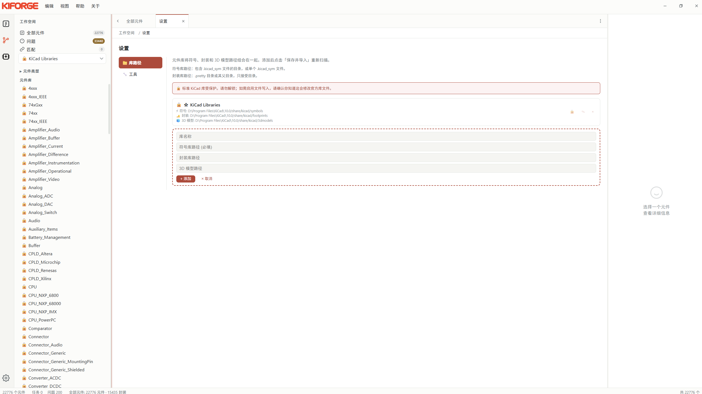

<div align="center">


# KIForge

KiCad 元件库（符号、封装库）管理器

 [](https://github.com/xiaomaitangjiang/KiCad_Forge/releases) [](https://github.com/xiaomaitangjiang/KiCad_Forge/blob/master/LICENSE) [](#下载) [](https://github.com/xiaomaitangjiang/KiCad_Forge/issues?q=is%3Aopen+is%3Aissue+label%3Abug)

Kicad_Forge 是一个现代化的元件库图形管理工具，旨在为 KiCad 多库文件、多元器件管理提供一种更加方便、迅捷、直观的管理工具。

简体中文 ~ [English](docs/README.en.md)

[源码构建](#源码构建) · [打包与 CI](#打包与-ci)


[功能](#功能) **·** [快速开始](#快速开始) **·** [下载](#下载) **·** [贡献](CONTRIBUTING.md) **·** [注意事项](docs/user/usage-notes.zh-CN.md)
</div>

---

## 功能

- **多元件库管理**： 元件库是符号库目录与封装库目录的集合，可附加 3D 模型目录；侧边栏按元件库分组浏览
- **批量导入**： 扫描 KiCad 库目录，自动解析 `.kicad_sym` / `.kicad_mod` 文件入库
- **搜索与过滤**： 按名称模糊搜索、按库筛选，快速定位器件
- **元件类型匹配**： 先按精确特例匹配，再执行 PCRE2 正则规则，未命中默认分类为 `Unknown`；支持选择名称、值、型号或位号字段，并编辑类型图标与颜色
- **自动关联检查**： 自动检查 Symbol↔Footprint↔3D 模型关联完整性
- **自动匹配**：启发式自动匹配封装
- **LCSC 导入**： 输入立创器件编号查找，选择目标元件库及其中的符号子库（已有或新建），再从自动找到的多个封装候选中选择复用，或新建封装
- **Git 版本管理**：在左侧面板查看库的变更、提交历史图、分支标记和文件差异，支持初始化仓库与提交
- **符号编辑**：支持复制、粘贴、剪切移动、全选，以及当前会话内的撤销和重做；整次导入不支持撤销
- **工作台**：页面分组、布局恢复、可关闭的“全部元件”页签；LCSC 与 Git 的完整界面位于最左侧侧边栏，窄窗口使用抽屉
- **插件系统**：支持独立 Python 进程和 TypeScript 前端插件；内置 [LCSC 元件导入](plugins/lcsc_import/) 与 [Git 版本管理](plugins/git_version/)，前端通过公共 SDK 扩展
- **跨平台分发**：Windows x64、macOS Apple Silicon / Intel、Linux x64；发行包内置 Python
- **多语言**：宿主界面支持中文 / English，插件的翻译覆盖范围由各插件决定

匹配规则支持样本预览和数据库预览。保存规则只更新配置；点击应用后才补齐现有数据中未分类的元件，已指定的类型保持不变。普通目录导入和 LCSC 导入使用同一份已保存规则。

## 快速开始

### 下载

从 [Releases](https://github.com/xiaomaitangjiang/KiCad_Forge/releases) 选择版本和 CPU 架构。当前源码与 CI 已配置下列格式，实际可下载文件以对应 Release 的 **Assets** 为准；尚未上传的文件可从源码构建。

| 平台 | 推荐格式 | 其他下载 |
| --- | --- | --- |
| Windows x64 | EXE 安装版 | ZIP 免安装版 |
| macOS Apple Silicon（arm64） | DMG | ZIP（`.app` 应用压缩包） |
| macOS Intel（x86_64） | DMG | ZIP（`.app` 应用压缩包） |
| Linux x64（Ubuntu/Debian） | DEB 安装版 | tar.gz / ZIP 免安装版 |

三个平台的发行包均内置 Python 3.12.15 和证书库，使用内置插件无需另装 Python 或手动安装 pip 依赖。Git 插件仍需系统安装 Git，并能通过 `PATH` 找到 `git`；LCSC 在线查询和下载需要网络。

### 如何使用

- **Windows**：运行 EXE 安装程序，或解压 ZIP 后运行 `KiCad_Forge.exe`。安装版默认安装到当前用户目录，可从开始菜单打开；桌面快捷方式为可选项。界面使用 WebView2，需要可用的 WebView2 Runtime。
- **macOS**：打开 DMG，将 `KiCad Forge.app` 复制到“应用程序”后打开；ZIP 解压后得到相同的 `.app`。两种格式均无需安装向导。当前未配置 Developer ID 签名和公证，首次打开可能受到系统安全检查限制。
- **Linux**：通过系统软件安装器打开 DEB，或在终端使用 `sudo apt install ./文件名.deb`；免安装版解压后运行 `KiCad_Forge`，仍需满足系统库依赖。

macOS、Linux 使用系统浏览器显示界面，需要可用的图形桌面环境；Linux 还需要 `xdg-open`（通常由 `xdg-utils` 提供）。

首次启动会尝试检测并导入本机已安装的 KiCad 官方元件库。未检测到库或需添加第三方库时，可进入“设置 → 库路径”配置符号、封装和可选的 3D 模型目录。

**注意**：符号路径支持目录或单个 `.kicad_sym` 文件；封装和 3D 模型路径必须是目录。下面是一种目录组织方式，不要求名称完全相同。

```text
EXT_Internal_kicad_Lib
├── 3DModels
├── Docs
├── Footprints
│   ├── EXT_ACDC.pretty
│   └── EXT_Example.pretty
└── Symbols
```



### 数据目录

| 平台 | 默认数据目录 |
| --- | --- |
| Windows | `%APPDATA%/KiCad_Forge/data/` |
| macOS `.app` | `~/Library/Application Support/KiCad_Forge/data/` |
| Linux | `~/.KiCad_Forge/` |

Windows、Linux 若在程序旁已有 `data/` 目录，会优先使用它；需要便携数据时，可在首次启动前手动创建，并确保可写。免安装版不会自动启用便携数据模式。macOS `.app` 始终使用用户数据目录。

升级前请备份数据库、配置和元件库文件。Windows 当前使用 NSIS 按用户安装；旧 Inno Setup 系统级安装的卸载登记独立，升级后如需移除旧版本，应单独卸载。

## 源码构建

以下工具仅用于开发和打包，使用已发布的发行包无需安装。

### 环境要求

- [xmake](https://xmake.io/) 3.0.9+（CI 固定 3.1.1）
- Python 3.12、Node.js 24、CMake
- Windows：[MSYS2](https://www.msys64.org/) 的 `mingw-w64-x86_64-clang`、`mingw-w64-x86_64-lld`、`mingw-w64-x86_64-gcc`，并将工具链的 `bin` 加入 `PATH`
- Linux：GCC 14 / G++ 14
- macOS：Xcode Command Line Tools / Apple Clang

PCRE2 及其他原生依赖由 `dependencies/` 中的归档、配方和校验记录锁定；先准备依赖并配置，再执行构建。下面的 Windows 示例假设 MSYS2 位于 `D:/msys64/mingw64`，请按本机路径调整。

常规构建直接使用仓库中的 `resources/icons/app.ico`；只有修改图标素材时才需安装 CairoSVG、Pillow，并手动运行 `scripts/svg2ico.py`。

### 准备前端

从仓库根目录执行：

```sh
npm ci --prefix webui
npm run build --prefix webui
node scripts/build_plugins.mjs
```

### 构建原生程序

Windows（PowerShell）：

```powershell
$env:MSYS2_DIR = "D:/msys64/mingw64"
python -B scripts/prepare_dependencies.py --plat mingw --arch x86_64 --mode release
$env:PCRE2_SDK_DIR = (Resolve-Path "build/dependencies/pcre2/mingw/x86_64/release/install").Path
xmake f -y -c -p mingw -a x86_64 -m release --portable_deps=y --mingw="$env:MSYS2_DIR"
xmake build -y -j 2 KiCad_Forge
```

Linux x64：

```sh
python3 -B scripts/prepare_dependencies.py --plat linux --arch x86_64 --mode release --cc gcc-14
xmake f -y -c -p linux -a x86_64 -m release --portable_deps=y --cc=gcc-14 --cxx=g++-14 --ld=g++-14 --sh=g++-14
xmake build -y -j 2 KiCad_Forge
```

macOS Apple Silicon（Intel 机器将两处 `arm64` 改为 `x86_64`）：

```sh
python3 -B scripts/prepare_dependencies.py --plat macosx --arch arm64 --mode release --cc clang
xmake f -y -c -p macosx -a arm64 -m release --portable_deps=y
xmake build -y -j 2 KiCad_Forge
```

程序位于 `build/<平台>/<架构>/release/`，Windows 入口为 `KiCad_Forge.exe`，其他平台为 `KiCad_Forge`。构建后会同步前端、插件、配置、许可证及 Windows 运行时 DLL。

直接运行源码构建目录中的程序时，插件仍使用 `PATH` 中的 `python`（Windows）或 `python3`（macOS/Linux）。私有 Python 在下面的 XPack 打包阶段装入发行包。

## 打包与 CI

在对应的原生系统上完成上述 Release 构建，再单独准备锁定的 Python、证书和打包工具。`--download` 只在显式准备阶段允许下载，所有文件按 `dependencies/packaging.lock.json` 校验；缓存齐全时可省略该参数。

Windows（PowerShell）：

```powershell
python -B scripts/prepare_packaging.py --platform mingw --arch x86_64 --download
xmake pack --autobuild=n -j 1 -o dist/installers
```

Linux x64（需有 `dpkg-deb`、`dpkg-shlibdeps` 和 `objdump`，通常由 `dpkg`、`dpkg-dev`、`binutils` 提供）：

```sh
python3 -B scripts/prepare_packaging.py --platform linux --arch x86_64 --download
xmake pack --autobuild=n -j 1 -o dist/installers
```

macOS Apple Silicon（Intel 机器将 `arm64` 改为 `x86_64`）：

```sh
python3 -B scripts/prepare_packaging.py --platform macosx --arch arm64 --download
xmake pack --autobuild=n -j 1 -o dist/installers
```

[XPack 配置](packaging/xpack.lua) 会生成下载表中对应平台的全部格式：Windows 使用 NSIS，macOS 使用系统 DMG 工具，Linux 使用原生 dpkg 工具生成 DEB。最终文件位于 `dist/installers/`；`build/` 保存编译产物与依赖，两个目录都不纳入 Git 提交。

[CI 工作流](.github/workflows/ci.yml) 先检查前端与 SDK，再执行四个平台的 Debug / Release，共 8 组原生构建和测试；Release 作业自动打包并上传构建产物。普通 push 和 PR 不发布 Release，只有显式启用 `publish_release` 的手动运行才会在全部检查通过后发布，标签格式为 `v主版本.次版本.修订号`。

## 项目结构

```
KiCad_Forge
├── config
├── dependencies
├── docs
├── examples
├── packaging
├── plugins
├── resources
├── scripts
├── sql
├── src
│   ├── classifier
│   ├── core
│   │   ├── db
│   │   ├── io
│   │   │   ├── parser
│   │   │   └── sexpr
│   │   │       ├── dom
│   │   │       └── token
│   │   ├── model
│   │   └── repo
│   ├── correspondence
│   ├── interface
│   │   ├── api
│   │   ├── manager
│   │   │   ├── binding
│   │   │   └── setup
│   │   └── service
│   │       ├── classification
│   │       ├── correspondence
│   │       ├── editing
│   │       ├── import
│   │       └── library
│   ├── platform
│   ├── plugin
│   ├── third_party
│   └── util
│       ├── container
│       └── template
├── tests
└── webui
```

## 插件系统

> **⚠️ 注意：插件以独立 Python 进程运行，拥有与主程序相同的文件系统访问权限，Kicad_Forge无法提供任何安全保证。请仅安装来自可信来源的插件，恶意插件可能读取、篡改或删除任意文件。**

插件可包含独立 Python 后端、TypeScript 前端，或两者。内置 LCSC 和 Git 插件的完整业务界面位于最左侧侧边栏。

- Python 后端通过 CLI 接收动作名与 JSON 参数，向 stdout 输出 JSON；宿主负责创建任务、跟踪状态与取消。发行包使用内置解释器，源码构建使用系统 Python。
- 前端通过 `@kiforge/plugin-sdk` 注册侧栏、工具栏和其他公共插槽，复用宿主的 React 与共享运行时。插件源码独立构建，不直接导入宿主内部模块。
- 当前内置插件使用 `manifestVersion: 2`：`python` 声明后端入口与动作，`frontend` 声明前端资源，`engines` 声明宿主与 SDK 兼容范围。旧 v1 清单仍有兼容路径。
- 用户插件目录位于数据目录的相邻 `plugins/`；应用自带插件位于发行包资源目录中的 `plugins/`，macOS 对应 `.app/Contents/Resources/plugins/`。

开发入口：

- [公共插件 SDK](webui/packages/plugin-sdk/README.md)：接口、插槽、任务、配置和构建规则。
- [示例插件](examples/plugins/README.md)：独立前端插件示例。
- [LCSC 清单](plugins/lcsc_import/manifest.json) / [Git 清单](plugins/git_version/manifest.json)：当前实际使用的 v2 清单。

## API

内置 HTTP 服务提供 REST API，完整文档见 [docs/api/http-api.md](docs/api/http-api.md)。

导入、LCSC 工作流和编辑命令的行为约束与验收场景见 [功能规格](docs/specs/README.md)。规格分别标注当前实现、拟定规则和未覆盖项。

| 端点 | 方法 | 说明 |
|---|---|---|
| `/api/status` | GET | 健康检查 / 心跳 |
| `/api/symbols` | GET | 符号列表（支持 `?q=`、`?library=`） |
| `/api/libraries` | GET/POST | 符号库的增删查改 |
| `/api/component-libraries` | GET/POST | 元件库目录集合的管理与导入 |
| `/api/plugins` | GET | 插件列表 |
| `/api/plugins/{id}/icon` | GET | 插件图标 |
| `/api/tasks` | POST | 提交插件动作并创建任务 |
| `/api/tasks/{task_id}` | GET | 读取任务状态与结果 |
| `/api/tasks/{task_id}/cancel` | POST | 请求取消可取消的任务 |
| `/api/classify` | POST | 运行分类规则 |
| `/api/check` | POST | 检查 Symbol↔Footprint↔3D 关联 |
| `/api/config` | GET/POST | 读写配置 |
| `/api/component-type-matching` | GET/POST | 读取或保存元件类型匹配规则；保存不执行分类 |
| `/api/component-type-matching/preview` | POST | 预览样本或数据库中的匹配结果，不写入数据库 |
| `/api/component-type-matching/apply` | POST | 按指定版本应用已保存规则，补齐未分类元件 |
| `/api/component-type-matching/reload` | POST | 重新加载数据目录中的匹配规则配置 |
| `/api/import` | POST | 导入目录（`?dir=`） |


## 技术栈

| 层 | 选择 |
|---|---|
| 语言 | C++23 |
| 编译器 | Windows：MSYS2 Clang；Linux：GCC 14；macOS：Apple Clang |
| 构建与打包 | xmake + XPack |
| 前端 | React 19 + Vite + TypeScript 插件 SDK |
| 数据库 | SQLite3 |
| HTTP | httplib（header-only） |
| 日志 | spdlog |
| 桌面界面 | Windows：[webview/webview](https://github.com/webview/webview) + WebView2；macOS/Linux：系统浏览器 |
| 插件运行时 | 发行包内置 Python 3.12.15 |
| 许可证 | MIT |

---

## Star History

<a href="https://www.star-history.com/?repos=xiaomaitangjiang%2Fkicad_forge&type=date&legend=top-left">
 <picture>
   <source media="(prefers-color-scheme: dark)" srcset="https://api.star-history.com/chart?repos=xiaomaitangjiang/kicad_forge&type=date&theme=dark&legend=top-left" />
   <source media="(prefers-color-scheme: light)" srcset="https://api.star-history.com/chart?repos=xiaomaitangjiang/kicad_forge&type=date&legend=top-left" />
   
 </picture>
</a>

## 贡献

欢迎提交 Issue 与 PR，流程与代码规范见 [CONTRIBUTING.md](CONTRIBUTING.md)。提交 BUG 时请附上详细描述与软件 Log 文件；谢绝"许愿式 Issue"，详见[注意事项](docs/user/usage-notes.zh-CN.md)。
