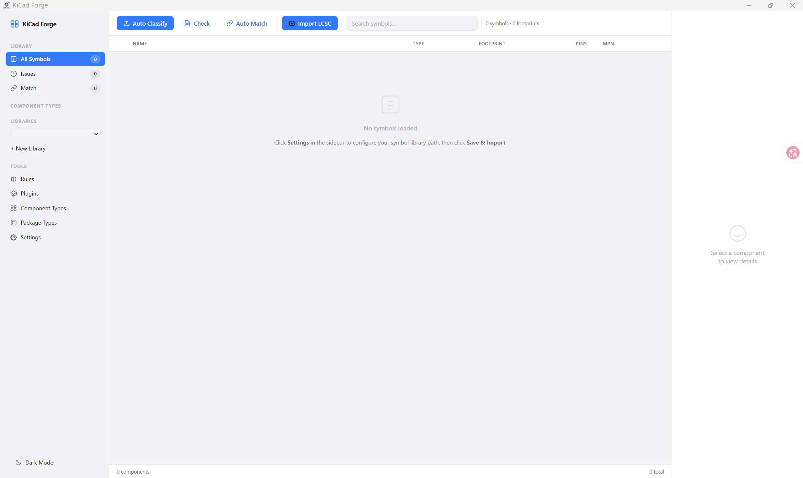

<div align="center">


# KiCad Forge

A library manager for KiCad (symbols & footprints)

 [](https://github.com/xiaomaitangjiang/KiCad_Forge/releases) [](https://github.com/xiaomaitangjiang/KiCad_Forge/blob/master/LICENSE) [](#download) [](https://github.com/xiaomaitangjiang/KiCad_Forge/issues?q=is%3Aopen+is%3Aissue+label%3Abug)

KiCad Forge is a modern graphical library manager, built to make managing multi-library files and large component collections in KiCad faster and more intuitive.

English ~ [简体中文](../README.md)



[Features](#features) · [Quick Start](#quick-start) · [Download](#download) · [Contributing](../CONTRIBUTING.md) · [Important Notes](Attention_en.md)
</div>

---

## Features

- **Multiple component libraries** — Bind symbol / footprint / 3D model directories into component libraries, browsed in groups in the sidebar
- **One-click batch import** — Scan a KiCad library directory and parse `.kicad_sym` / `.kicad_mod` files automatically (22,000+ symbols imported in seconds in real tests)
- **Search & filter** — Fuzzy search by name, filter by library, locate parts quickly
- **Automatic classification** — Rule engine labels symbols with types (resistor, MCU, sensor...); custom types and rules are supported
- **Link checking & auto-matching** — Check Symbol↔Footprint↔3D model link integrity, heuristic auto-matching for footprints
- **Plugin system** — Python plugins run as independent processes, UI driven by `manifest.json`; ships with an [LCSC component importer](../plugins/lcsc_import/) and a [Git version manager](../plugins/git_version/) plugin
- **Bilingual UI** — 中文 / English (i18next)
- **Portable storage** — Local SQLite database, data directory travels with the app

## Quick Start

### Prerequisites

- [xmake](https://xmake.io/)
- [MSYS2](https://www.msys64.org/): `mingw-w64-x86_64-clang` toolchain, plus `mingw-w64-x86_64-sqlite3` and `mingw-w64-x86_64-fmt`
- Python 3.10+: `pip install cairosvg Pillow` (used to generate the app icon from SVG)
- Node.js (React 19 + Vite frontend)

> Defaults to `D:/msys64/mingw64`; set the `MSYS2_DIR` environment variable to point to a different MSYS2 installation.

### Build & Run

```bash
# 1. Install frontend dependencies
cd webui && npm install && cd ..

# 2. Configure and build (debug)
xmake f -p mingw -c
xmake build

# Or build a release version
xmake f -m release && xmake build
```

The binary lands at `build/mingw/x86_64/<mode>/KiCad_Forge.exe`. After building, `after_build` automatically copies webui, plugins, config, and the runtime DLLs into the output directory — just double-click the exe to run (embedded WebView2 window).

### Data Directory

Portable-first: data (SQLite database, settings) lives in a `data/` folder next to the exe; if that is not writable, it falls back to `%APPDATA%/KiCad_Forge/data/`.

## Project Structure

```
KiCad_Forge
├── config
├── docs
├── plugins
├── resources
├── scripts
├── sql
├── src
│   ├── classifier
│   ├── core
│   │   ├── db
│   │   ├── io
│   │   │   ├── parser
│   │   │   └── sexpr
│   │   │       ├── dom
│   │   │       └── token
│   │   ├── model
│   │   └── repo
│   ├── correspondence
│   ├── interface
│   │   ├── api
│   │   ├── manager
│   │   │   ├── binding
│   │   │   └── setup
│   │   └── service
│   │       ├── classification
│   │       ├── correspondence
│   │       ├── import
│   │       └── library
│   ├── platform
│   ├── plugin
│   ├── third_party
│   └── util
│       ├── container
│       └── template
├── tests
└── webui
```

## Plugin System

> **⚠️ Note: Plugins run as independent Python processes with the same filesystem access as the host application — KiCad Forge cannot provide any security guarantee. Only install plugins from trusted sources; a malicious plugin can read, modify, or delete arbitrary files.**

Plugins live in `plugins/`, one folder per plugin, containing `manifest.json` + Python scripts. The backend invokes them via CLI: `python plugin.py <action> '<json_args>'`; the plugin outputs JSON to stdout.

**manifest.json**

```json
{
  "id": "com.kicad_forge.lcsc_import",
  "name": "LCSC Component Importer",
  "version": "1.1.0",
  "author": "KiCad Forge",
  "description": "Download symbols, footprints, and 3D models from LCSC by part number",
  "license": "MIT",
  "entry": "plugin.py",
  "entry_function": "import_component",
  "icon": "icon.svg",
  "capabilities": ["import"],
  "one_click": true,
  "actions": [
    {
      "id": "import",
      "name": "Import LCSC",
      "description": "Import a component from LCSC by part number",
      "trigger": "dialog",
      "template": "two_step",
      "analyze_action": "analyze",
      "protocol": "staged-import-v1",
      "icon": "icon.svg",
      "button": {
        "show": true,
        "style": "both",
        "location": "sidebar",
        "tooltip": "Download from LCSC"
      },
      "schema": {
        "fields": [
          { "key": "lcsc_id", "label": "LCSC Part Number", "type": "text", "required": true },
          { "key": "target_library", "label": "Target Symbol Library", "type": "library_picker", "required": true },
          { "key": "footprint_choice", "label": "Footprint", "type": "search_picker",
            "source": "footprints", "near_from": "footprint_name" }
        ]
      }
    },
    {
      "id": "analyze",
      "name": "Analyze LCSC",
      "description": "Download and inspect without writing to the library",
      "trigger": "hidden",
      "button": { "show": false }
    }
  ],
  "dependencies": {
    "python": ">=3.10",
    "pip": ["easyeda2kicad"]
  }
}
```

**Top-level fields**

| Field | Description |
|---|---|
| `id` / `name` | Unique plugin ID and display name (required) |
| `version` / `author` / `description` / `license` | Plugin metadata |
| `entry` | Entry script, defaults to `plugin.py` |
| `entry_function` | Entry function name (reserved) |
| `icon` | Plugin icon (SVG) |
| `capabilities` | Capability declarations (e.g. `import`, `tool`) |
| `one_click` | Whether the plugin supports one-click execution |
| `actions` | Action list, see table below |
| `dependencies` | Runtime dependencies: `python` version constraint and `pip` packages |
| `min_app_version` / `platforms` | Optional: minimum app version / supported platforms |

**actions[] fields**

| Field | Description |
|---|---|
| `trigger` | `"dialog"` popup form / `"inline"` one-click execution (default) / `"hidden"` hidden action (referenced by templates) |
| `template` | UI template: `"two_step"` two-step flow (analyze & preview first, then confirm import) |
| `analyze_action` | id of the hidden analyze action referenced by the `two_step` template |
| `protocol` | `"staged-import-v1"` staged import protocol |
| `preflight` | action id executed before the dialog opens; its result (e.g. Git status) is shown at the top of the form |
| `auto_args` | Argument keys filled in automatically by the host (e.g. `target_library`) |
| `button.show` | Show the button (default `true`) |
| `button.style` | `"icon"` / `"text"` / `"both"` (default) |
| `button.location` | `"toolbar"` (default) / `"sidebar"` |
| `button.tooltip` | Button tooltip |

**schema.fields[] supported field types**

| `type` | Description |
|---|---|
| `text` | Text input (default) |
| `library_picker` | Dropdown for picking a symbol library |
| `search_picker` | Searchable candidate list (e.g. footprint search), used with the `two_step` template |

**style: icon**


**style: both**


**style: text**


## API

The built-in HTTP server exposes a REST API. Full documentation: [docs/API.md](API.md) (Chinese).

| Endpoint | Method | Description |
|---|---|---|
| `/api/status` | GET | Health check / heartbeat |
| `/api/symbols` | GET | List symbols (`?q=`, `?library=`) |
| `/api/libraries` | GET/POST | Library CRUD |
| `/api/plugins` | GET | List plugins |
| `/api/plugins/{id}/icon` | GET | Plugin icon |
| `/api/plugins/execute` | POST | Execute a plugin action |
| `/api/classify` | POST | Run classification rules |
| `/api/check` | POST | Check Symbol↔Footprint↔3D links |
| `/api/settings` | GET/POST | Read/write settings |
| `/api/import` | POST | Import a directory (`?dir=`) |

## Download

Grab the latest release from [Releases](https://github.com/xiaomaitangjiang/KiCad_Forge/releases):

- **Windows**: an installer is provided — download and run
- Other platforms: no prebuilt packages yet, please build from source (see [Quick Start](#quick-start))

## Tech Stack

| Layer | Choice |
|---|---|
| Language | C++23 |
| Compiler | clang 22 (MSYS2, MinGW target) |
| Build | xmake |
| Frontend | React 19 + Vite |
| Database | SQLite3 |
| HTTP | httplib (header-only) |
| Logging | spdlog |
| WebView | [webview/webview](https://github.com/webview/webview) (WebView2 Runtime on Windows) |
| License | MIT |

---

## Contributing

Issues and PRs are welcome — workflow and code conventions in [CONTRIBUTING.md](../CONTRIBUTING.md). When filing a bug, please include a detailed description and the application's log file. "Wishful" issues are discouraged; see [Important Notes](Attention_en.md).
