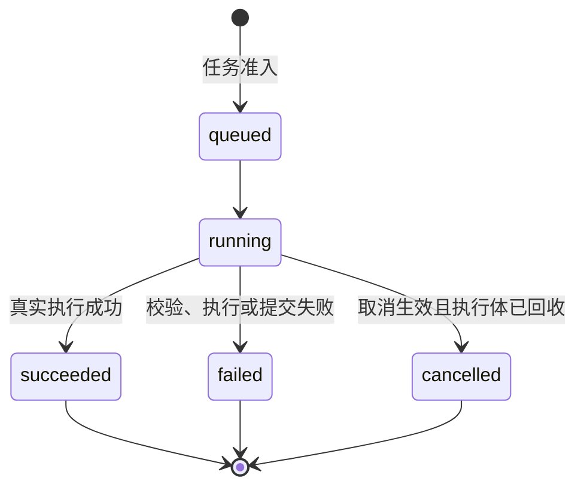

# 任务化导入协议规格

快照日期：2026-10-19。状态：当前任务 API、SDK 适配与 `staged-import-v1` 的行为基线。普通目录导入见 [导入核心](IMPORT_CORE.md)，界面步骤见 [LCSC 流程](LCSC_IMPORT_WORKFLOW.md)。

## 公共入口

| 编号 | 入口 | 行为 |
| --- | --- | --- |
| IP-001 | SDK `imports.analyze({provider, externalId})` | 解析提供者的 analyze 动作，通过任务 API 执行并等待终态，成功后映射分析 DTO；不是返回 TaskHandle 的方法 |
| IP-002 | SDK `imports.commit(selection)` | 创建提供者的暂存导入任务，返回 `TaskHandle<ImportResult>` |
| IP-003 | SDK `imports.cancel(taskId)` | 请求取消任务；取消请求不直接形成 cancelled 终态 |
| IP-004 | SDK `imports.operation(operationId)` | 查询已提交操作；只有明确的 operation_not_found 映射为 null，其它错误保留 |
| IP-005 | HTTP | 创建、读取、取消分别为 `POST /api/tasks`、`GET /api/tasks/{id}`、`POST /api/tasks/{id}/cancel`；历史结果为 `GET /api/imports/operations/{id}` |

不存在与 SDK 方法同名的 `/api/imports/analyze`、`/api/imports/commit`、`/api/imports/cancel` 路由。当前旧 execute 路由与上一轮删除决定的差异见 [索引](README.md#当前源码与既有决定的差异)；新增客户端不依赖该路由。

实现：[SDK 类型](../../webui/packages/plugin-sdk/src/index.ts)、[tasks-api](../../webui/src/plugin-host/tasks-api.js)、[loader 提供者解析](../../webui/src/plugin-host/loader.js)、[HTTP 路由](../../src/interface/api/routes.cpp)。

## 一次明确导入的请求

以下 UUID 是占位值，实际调用必须使用当前列表返回的身份；`operation_id` 对应一次已确认意图。

```json
{
  "plugin_id": "com.kicad_forge.lcsc_import",
  "action": "import",
  "args": {
    "lcsc_id": "C12345",
    "target_component_library_id": "<package-uuid>",
    "symbol_library_choice": { "mode": "existing", "path": "Analog/Device.kicad_sym" },
    "footprint_choice": { "mode": "reuse", "footprint_id": "<footprint-uuid>" },
    "operation_id": "lcsc-example-001"
  }
}
```

SDK 对应 `provider/externalId/targetComponentLibraryId/symbolLibraryChoice/footprintChoice/operationId`；封装复用使用 `footprintId`。`symbolLibraryChoice` 内部仍为 `{mode, path}` 或 `{mode, name}`，不把相对路径当 UUID。

| 编号 | 字段和身份规则 |
| --- | --- |
| IP-010 | `task_id` 标识执行；`operation_id` 标识确认意图；`client_request_id` 是任务关联字段，没有服务端提交去重保证，不能替代 operation_id。 |
| IP-011 | 提供者以插件 ID 定位；SDK 可接受现有 LCSC 别名，但动作选择依 manifest 中唯一 `staged-import-v1` 动作及其 analyze_action，不要求第三方动作必须叫 import/analyze。 |
| IP-012 | 包模式 `target_component_library_id` 与旧符号库 `target_library_id` / 路径回退互斥。不得改变旧字段语义。包需要存在、启用、可写、未锁定/保护，符号与封装目标齐全。 |
| IP-013 | 包内子库 existing 只接受列表给出的根内相对路径；new 只接受合法单文件 stem，提交时创建 `.kicad_sym`，不得覆盖已有文件。旧客户端未传子库选择有默认落点，新界面必须显式选择。 |
| IP-014 | 包模式必须显式给出封装模式 new/reuse。reuse 使用已登记 UUID；多个兼容 UUID 字段同时出现时必须一致。new 不得夹带旧 UUID。名称和候选排序不能代替身份。 |
| IP-015 | 真正的 LCSC 插件在包模式下统一去空白、补 C、转大写，只允许 C+数字；第三方外部编号不受此专用规则约束。 |

字段校验：[staged_import.h](../../src/interface/api/staged_import.h)、[解析与宿主提交](../../src/interface/api/staged_import.cpp)。

## 执行状态与取消



`phase` 是另外一维。暂存导入从 queued/staging 进入 committing；普通动作可无子阶段。不可用单一 phase 推断终态。

| 编号 | 当前规则 |
| --- | --- |
| IP-020 | 任务准入与插件启停共用 TaskService。停用后拒绝新任务；停用对可取消任务发出取消请求，对已进入提交的任务等待真实结果。 |
| IP-021 | 插件只向宿主分配的私有暂存目录写转换产物。宿主解析 manifest 和 KiCad 内容，校验路径、根节点、名称、对象数量及复用身份，再决定最终目标。不是操作系统沙箱，不能据此承诺插件无法访问其它文件。 |
| IP-022 | 取消与 `try_enter_commit()` 由同一任务锁裁决。取消先到：闸门拒绝，不开始本次目标文件/数据库提交；提交先到：取消返回 not_cancelable，任务继续到真实终态。暂存写入本身可以已发生。 |
| IP-023 | 取消回执为 cancel_requested、already_requested、not_cancelable 或 terminal；cancel_requested 不能显示为已取消。只有执行体和子进程回收后才发布 cancelled。 |
| IP-024 | 终态只发布一次。Python 进程退出成功但业务 JSON `ok:false` 时仍为 failed，保留原 result 和具体原因。超时、中断等不能确定写入结果时可标 uncertain，不能自动断言无副作用。 |
| IP-025 | 校验后、提交前仍复核 owner、包路径、锁定/保护、源摘要及 expected_missing，拒绝覆盖外部修改。多文件发布和数据库写入复用 SourceMutationService 的故障回滚与恢复。 |

实现：[TaskService](../../src/plugin/task_service.h)、[状态裁决](../../src/plugin/task_service.cpp)、[StagedImporter](../../src/interface/api/staged_import.cpp)、[源文件 mutation](../../src/core/io/source_mutation.h)。

## 幂等与恢复

| 编号 | 当前规则 |
| --- | --- |
| IP-030 | 相同 operation_id 和相同请求摘要返回已保存结果并标 replayed，不再转换或写库；相同 ID 换内容必须拒绝。摘要涵盖插件、动作、provider、外部编号、目标身份及封装选择。包模式目标身份含包 ID 和规范目标路径。 |
| IP-031 | 重试保持原 operation_id；改变编号、包、子库、封装选择等确认意图时生成新 ID。服务端允许省略并生成 ID，但客户端将失去原请求失联后的稳定重试身份。 |
| IP-032 | 既有成功回放优先于新文件已存在检查、复用封装当前行检查及新的匹配健康门；不是完全绕过所有入口/目标校验，也不是收到任意旧 ID 就无条件成功。 |
| IP-033 | `import_operations` 保存已提交结果；查询未知 ID 返回 404 operation_not_found，只读且不创建新记录。404 本身不能证明没有在途任务或永远没有发生副作用。 |
| IP-034 | 任务终态记录默认最多保留 256 条，活跃任务不淘汰；进程重启后任务内存状态不持久。操作结果存在数据库，与任务保留策略不同；当前未定义按时间自动过期策略。 |
| IP-035 | 提交成功后列表刷新失败只允许重读；禁止用新 operation_id 重发同一导入来“修复刷新”。任务结果未知时先保留原意图、查询任务/操作，再决定重试。 |
| IP-036 | 幂等重放和相同内容 noop 分开：replayed 是历史结果，noop 是新操作经当前文件/身份校验确认无须修改。旧成功结果不能当成当前文件仍完整的证明。 |
| IP-037 | 当前 SDK 每次任务读取结束后等待 250ms 再读取；读取错误保留上次快照并继续尝试，不自动发明 failed/cancelled。任务 404、服务重启或持续断连没有自动恢复终态的保证，客户端应允许退出等待并凭原 operation_id 核对结果。 |

## 容量与错误

TaskService 默认上限为全局 16、单插件 4 个并发 worker（含收尾），终态保留 256；使用已有 TaskHandle 串行读取与释放，不再为面板单独增加轮询器。TaskHandle 的公共成员是 `id/getSnapshot/subscribe/cancel`，内部 done/dispose 不是插件可依赖的公共契约。

| 条件 | 当前 HTTP 语义 |
| --- | --- |
| 非对象 JSON、缺 plugin_id/action、args 非对象 | 400 invalid_request |
| 未知插件 / 动作 | 404 plugin_unknown / action_unknown |
| 插件停用 | 409 plugin_disabled |
| 并发已满 | 429 busy |
| 任务服务不可用 | 503 unavailable；已停止服务按 stopped 上报 |
| 任务未知或已淘汰 | 404；SDK tasks.get 映射 null |
| 操作未知 | 404 operation_not_found；SDK imports.operation 映射 null |
| 已准入后转换、校验、提交失败 | 任务终态 failed 及 error/result；不能仅凭读取任务 HTTP 200 当作导入成功 |

## 验收映射与差距

| 场景 | 规则 | 既有用例 |
| --- | --- | --- |
| 取消先到 / 提交先到 | IP-022、023 | [test_task_service.cpp](../../tests/cpp/test_task_service.cpp) T4.8a / T4.8b |
| 停用、并发限制、终态保留、worker 回收 | IP-020、034 | 同上 T4.1–T4.6、completed workers 用例 |
| 业务失败、超时不确定、进程树回收 | IP-024 | 同上 T4.5、T4.11、T4.4 |
| 同意图重放、换目标拒绝、越暂存目录拒绝 | IP-021、030 | [test_library_workflows.cpp](../../tests/cpp/test_library_workflows.cpp) staged import、LOCAL_AUDIT、FIX03 用例 |
| 子库为空/未登记、新建冲突与失联重试 | IP-013、032 | 同上 LCSCSUB 用例组 |
| DTO 映射、provider、operation 404、取消回执、释放 | IP-001–005、010 | [tasks-api.test.mjs](../../webui/tests/unit/tasks-api.test.mjs) |
| 真实离线宿主协议 | IP-021、025、030 | [run-import-contract-e2e.mjs](../../webui/tests/e2e/run-import-contract-e2e.mjs) |

本轮未重跑上述业务用例。并发相同 operation_id 的全部交错、真实进程中断各点、跨进程目标竞争仍需按当前实现独立验证，不从幂等串行回放或单个恢复用例推出“全场景恰好执行一次”。

任务并发与终态数量上限不等于暂存产物大小、磁盘占用和解析输入大小都已设限；这些资源边界须单独核对，不能从 16/4/256 三个默认值扩大结论。
