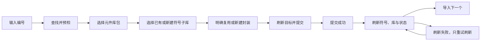

# LCSC 导入流程规格

快照日期：2026-10-19。状态：当前首方 LCSC 模型和界面行为基线；本轮未实现新功能或重跑业务测试。任务协议见 [IMPORT_PROTOCOL](IMPORT_PROTOCOL.md)，通用编辑命令见 [EDITING_COMMANDS](EDITING_COMMANDS.md)。

## 用户流程与状态

界面位置遵守 [工作台与内置插件界面位置 WP-001–009](WORKBENCH_PLACEMENT.md)：当前内置 LCSC 的完整流程只在最左侧主侧栏呈现，不通过侧栏摘要跳转中心详情页。以下流程与 LW 规则不因位置迁移改变。

界面 `step` 为 lookup/target/symbol/footprint；busy、completed、refreshing、refreshSucceeded 是独立状态，不根据按钮文字推导提交结果。

## 查号与目标选择

| 编号 | 当前规则 |
| --- | --- |
| LW-001 | 去除首尾空白、统一大写、纯数字补 C；空输入与非法格式分别提示，不请求下载。相同在途编号的 Enter/双击同步防重，不依赖重绘后的 disabled。 |
| LW-002 | 改编号使旧查找、旧 finally、旧候选及目标选择失效。请求身份不是编号字符串，同编号的两次请求也不能互相冒充。 |
| LW-003 | 分析结果保留同名但 UUID 不同的候选；损坏候选剔除并提示数量，查询失败应呈现警告/错误，不能伪装为“没有匹配”。 |
| LW-004 | 包列表显示不可用原因；停用、锁定、保护、缺符号路径、缺封装路径的包不能作为可写目标。包 UUID 与符号库 UUID 分开。 |
| LW-005 | 用户明确确认目标包；保存目标 ID、名称、路径和保护等快照。切换包清除子库、封装选择及旧 operation_id。 |
| LW-006 | 子库从包内真实 `.kicad_sym` 文件列表选择，含空库和未登记文件；空 UUID 不代表该实际文件无效。身份使用列表返回的相对 path，不能只按文件名区分嵌套同名文件。 |
| LW-007 | 子库不默认选中。新建输入为单个 stem，可去除一次 `.kicad_sym` 后缀；拒绝路径、保留名称及按宿主大小写语义冲突的名称。新文件只在提交阶段创建。 |
| LW-008 | 子库读取中阻止继续；损坏响应与真正空列表区分，失败不能沿用旧列表。切换子库清除封装意图。 |
| LW-009 | 封装复用必须明确选中可用候选 UUID；不默认复用 top1，也不默认新建。同名不同 UUID 保持独立行。无效或未经检查的候选不能提交。手动搜索旧结果不能覆盖新查询。 |

实现：[model.js](../../plugins/lcsc_import/frontend/src/model.js)、[校验和请求构造](../../plugins/lcsc_import/frontend/src/lcscImport.js)、[界面](../../plugins/lcsc_import/frontend/src/LcscImportModal.jsx)、[Python 分析](../../plugins/lcsc_import/plugin.py)。

## 提交与重试

| 编号 | 当前规则 |
| --- | --- |
| LW-010 | 点击导入即同步冻结编号、返回、目标及候选等编辑；普通关闭请求在 busy/refreshing 时拒绝。重复点击不得创建第二个导入任务。普通侧栏切换的生命周期另见 LW-020。 |
| LW-011 | 提交前重新获取包列表；失败、包被删除或不可写时终止提交。目标快照变化时返回目标确认并清除下游选择，要求用户重新确认。 |
| LW-012 | 再取子库列表并校验实际落点；已有在途/失败意图重试沿用原 operation_id，让宿主优先回放成功记录，避免首次成功创建的新文件误阻断网络失败后的重试。 |
| LW-013 | 一个确认意图只生成一次 operation_id；提交体包括规范编号、包 UUID、显式子库和封装选择。修改意图后生成新 ID，不把 task_id 当幂等键。 |
| LW-014 | 外层请求失败、任务失败、内层 `plugin_result.ok:false` 都算失败，优先显示具体原因。收到 HTTP 成功或 Python 进程成功不等于提交成功。 |
| LW-015 | 宿主确认提交成功后先设置 completed，再刷新。即使刷新失败，保留 completed、operation_id 和冻结状态；不能重新执行 import，只显示重试刷新入口。 |
| LW-016 | 首方入口通过 `commands.refreshAll` 等待所需读取；独立界面兼容调用按 symbols/libraries/status 顺序检查实际结果，null 或错误形状不能当作成功。刷新中的重复重试同步拒绝。 |
| LW-017 | completed 且 refreshSucceeded，且不在 busy/refreshing 时才允许“导入下一个”。开始新意图清除编号、目标、选择、operation_id、任务与旧查询归属，保留已读取包列表。 |
| LW-018 | 失败前没有提交时可解除冻结以修正输入；提交成功后不能靠返回、改编号或重新点击导入绕开 completed。结果未知按原意图重试，不能生成新 ID 猜测结果。 |

## 生命周期与取消

| 编号 | 当前规则 |
| --- | --- |
| LW-020 | 首方插件在 apply 阶段持有业务模型，React 界面只订阅。普通面板切换释放 UI 订阅，后台已发送任务和提交后刷新继续；重新打开看到同一模型状态，不重建导入意图。 |
| LW-021 | 独立界面 suspend/activate 用 epoch 处理卸载和 StrictMode replay；停用/销毁释放模型、任务订阅与适配器等待者。释放本地订阅本身不能视为服务端任务已经取消。 |
| LW-022 | lookup 的 onTask 绑定查询 token 与 epoch；import 的 onTask 绑定 operation_id 与 epoch。旧 C1 handle 迟到不能替换当前 C2 的状态或取消目标。同步终态通知也需释放订阅。 |
| LW-023 | 取消按钮只对当前 handle 且快照 cancelable 时发请求；取消与提交由宿主裁决，not_cancelable 不得显示为取消成功。不把“取消”用作撤销已经写入的导入。 |
| LW-024 | 模型复用公共快照 store 和 SDK 任务客户端；等值 patch 不发布新快照，面板不新增任务轮询或积累浏览历史缓存。dispose 后不再发新请求。 |

实现：[插件入口](../../plugins/lcsc_import/frontend/src/index.tsx)、[模型](../../plugins/lcsc_import/frontend/src/model.js)、[任务适配器](../../plugins/lcsc_import/frontend/src/task-adapter.js)、[SDK 任务客户端](../../webui/src/plugin-host/tasks-api.js)。适配器内部方法仍叫 executePlugin，但正常路径调用 `tasks.run`，不说明它访问旧 execute HTTP。

## 验收场景

| 场景 | 规则 | 已有用例或检查入口 |
| --- | --- | --- |
| 编号规范化、双击、A/B 逆序、同 ID 重试 | LW-001、002 | [lcscImport.test.js](../../webui/tests/lcscImport.test.js)、[lcsc-model.test.mjs](../../webui/tests/lcsc-model.test.mjs) |
| 目标锁定/删除/改路径，刷新包列表失败 | LW-004、005、011 | 同上；断言不创建提交任务并要求重新确认 |
| 空 UUID、空库、嵌套同名、新建名称冲突 | LW-006–008 | 同上、[test_library_workflows.cpp](../../tests/test_library_workflows.cpp) LCSCSUB |
| 同名不同 UUID、损坏候选、旧搜索结果 | LW-003、009 | [test_lcsc_workflow.py](../../tests/test_lcsc_workflow.py)、前端纯函数与模型测试 |
| 提交成功但刷新失败，重复点刷新 | LW-015、016 | [lcsc-model.test.mjs](../../webui/tests/lcsc-model.test.mjs)；一次 import，后续只重新读取 |
| 面板卸载时导入仍执行，重开后第二次意图 | LW-017、020 | [run-lcsc-browser.mjs](../../webui/tests/run-lcsc-browser.mjs) inline 场景 |
| 迟到 handle、同步终态、销毁后不读取 | LW-021、022、024 | [lcsc-model.test.mjs](../../webui/tests/lcsc-model.test.mjs) |
| 暂存编号文件名、恶意名称、reuse 不产封装 | IP-021、LW-014 | [test_lcsc_staging.py](../../tests/test_lcsc_staging.py) |

## 限制

LCSC 主体 JS 保持 `checkJs:false`，声明文件和类型化入口不代表全部实现已静态检查。离线夹具不代表在线供应商服务、真实大库、原生文件对话框及所有中断点已验收。成功导入没有用户级撤销/重做能力；相应需求见编辑规格，不能用删除后重导代替完整撤销。
